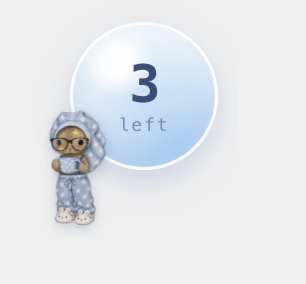
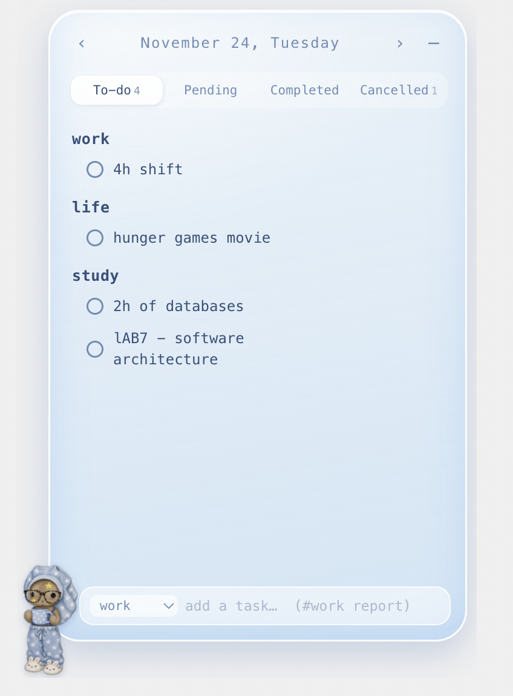
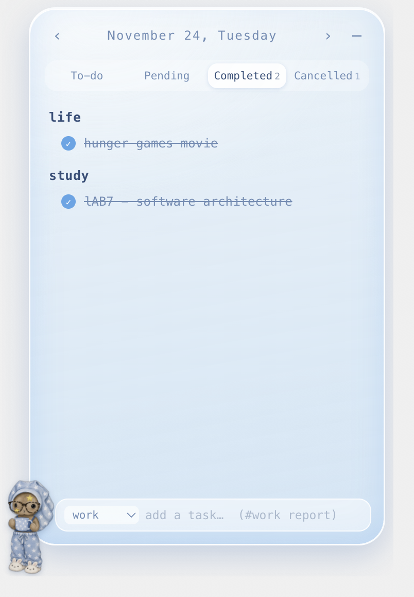

# To-do Ball 🫧

A tiny crystal-blue to-do list that floats in the corner of your Mac as a little ball. It stays on top of every app, every desktop and even fullscreen windows. The number inside shows how many tasks you have left today. Click it to open your list.

<p align="center">
  
</p>

<p align="center">
  
  &nbsp;&nbsp;
  
</p>

## Features

- 🫧 **Floating ball** that stays on top of everything, with today's task count inside
- 🐻 **A little mascot** sitting on the edge of the ball and the panel
- 📅 **Daily and weekly lists**: switch between today's tasks and a list for the whole week (with a progress bar)
- 🗂️ **Four tabs**: To-do, Pending, Completed and Cancelled
- 🏷️ **Three categories**: work, study and life
- ↷ **Push to tomorrow** (or next week) with one click
- 🔁 **Unfinished tasks roll over** to the next day or week by themselves
- 🖱️ **Drag the ball** anywhere, and it remembers where you left it
- 🚀 **Opens at login** so it's always there
- 💾 **Saves everything on your Mac**, with no account and no internet needed

## Install (Mac)

1. Download **To-do-Ball.zip** from the [Releases](../../releases) page and unzip it.
2. Drag **To-do Ball.app** into your **Applications** folder.
3. The app isn't signed by Apple, so macOS will block it the first time. Open **Terminal** and run:
   ```bash
   xattr -cr "/Applications/To-do Ball.app"
   ```
   Or open it, then go to **System Settings → Privacy & Security** and click **Open Anyway**.
4. Open the app. The ball appears in the top-right corner.
5. Right-click the ball and tick **Open at login**.

> Works on Macs with Apple chips (M1, M2, M3 and later).

## How to use it

| Do this | To |
|---|---|
| Click the ball | Open your list |
| Click anywhere else, press **Esc**, or click **–** | Close it back into the ball |
| Drag the ball or the top of the panel | Move it |
| Right-click the ball | Open at login · Move back to corner · Quit |
| **Daily / Weekly** switch | Swap between today's list and this week's list |
| **‹ ›** next to the date | Go to other days or weeks (click the date to jump back) |
| Type in the box at the bottom and press **Enter** | Add a task |
| Pick **work / study / life** from the menu, or type `#study revise ch 4` | Choose the category |
| Click the circle | Mark a task done |
| Hover a task | `‖` pending · `↷` tomorrow / next week · `×` cancel · `↺` back to to-do · `⌫` delete |
| Double-click a task | Edit it |

The number on the ball counts **today's daily tasks** that are still in To-do or Pending.

## Run from the code

You need [Node.js](https://nodejs.org) (LTS).

```bash
git clone https://github.com/amal-62/Floating-to-do-ball.git
cd Floating-to-do-ball
npm install
npm start
```

<details>
<summary>If you see "Electron failed to install correctly"</summary>

Electron's download sometimes stops halfway. Download it by hand:

```bash
cd node_modules/electron
VER=$(node -p "require('./package.json').version")
ARCH=$(uname -m | sed 's/x86_64/x64/')
curl -L --fail -o electron.zip "https://github.com/electron/electron/releases/download/v$VER/electron-v$VER-darwin-$ARCH.zip"
rm -rf dist && mkdir dist
ditto -x -k electron.zip dist
printf "Electron.app/Contents/MacOS/Electron" > path.txt
rm electron.zip
cd ../..
npm start
```
</details>

## Build the app yourself

```bash
npm run build
cp -R dist/mac*/"To-do Ball.app" /Applications/
xattr -cr "/Applications/To-do Ball.app"
codesign --force --deep --sign - "/Applications/To-do Ball.app"
open "/Applications/To-do Ball.app"
```

## Built with

Plain **HTML, CSS and JavaScript**, with **Electron** to make the window float above every app.

| File | What it does |
|---|---|
| `index.html` | the ball and the panel |
| `style.css` | the crystal-blue look, sizes and colours |
| `app.js` | tasks, tabs, daily/weekly, saving and dragging |
| `main.js` | the see-through floating window |
| `preload.js` | connects the page to the window |
| `mascot.png` | the little bear |

## Make it yours

- **Colours**: the variables at the top of `style.css` (`--glass-top`, `--glass-bottom`, `--ink`)
- **Ball size**: `#ball` in `style.css`, and the `ball` window size in `main.js`
- **Mascot**: swap `mascot.png` for any transparent PNG, and set its size with `.mascot-ball` and `.mascot-panel` in `style.css`
- **Categories**: `CATS` in `app.js`, plus the options in `index.html`
